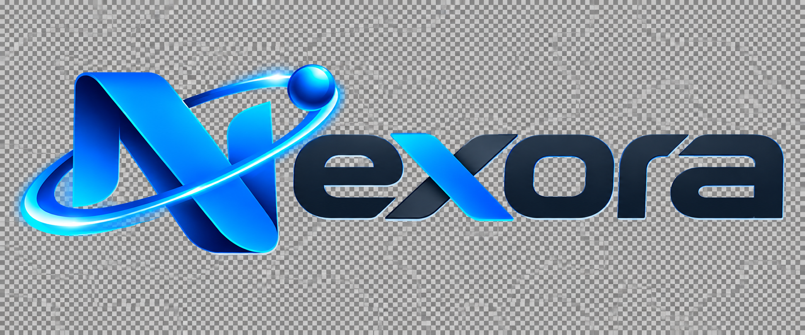

# Nexora

<div align="center">



**Site institucional da plataforma que conecta gestão, vendas em campo e comércio digital.**

[](https://www.php.net/)
[](https://laravel.com/)
[](https://tailwindcss.com/)
[](https://vite.dev/)

</div>

## Sobre o projeto

Este repositório contém o site institucional da **Nexora**, uma plataforma empresarial idealizada para reunir ERP, força de vendas e e-commerce em um mesmo ecossistema.

O site apresenta os produtos, comunica o posicionamento da marca e recebe solicitações de demonstração e contato. Ele não contém a implementação dos sistemas ERP, NexoraFDV ou e-commerce.

### Produtos apresentados

| Produto | Proposta | Estado exibido no site |
|---|---|---|
| **Nexora EMS ERP** | Gestão modular de finanças, fiscal, compras, estoque, produção, pessoas, logística e vendas, com IA contextual | Disponível para demonstração |
| **NexoraFDV** | Visitas, pedidos, roteiros, metas e comissões conectados ao ERP, inclusive em cenários offline | Pré-lançamento |
| **Nexora E-commerce** | Catálogo, estoque, pedidos e expedição integrados à operação | Em desenvolvimento |

## Funcionalidades do site

- Landing pages responsivas para a marca e seus três produtos.
- Demonstração interativa do fluxo entre ERP, força de vendas e e-commerce.
- Formulário de agendamento de demonstração.
- Formulário de contato.
- Envio de leads por e-mail com atalho de resposta via WhatsApp.
- Validação dos formulários no servidor e proteção CSRF.
- Navegação por teclado, link de salto para o conteúdo e suporte a `prefers-reduced-motion`.
- Animações progressivas com `IntersectionObserver`.

## Tecnologias

| Camada | Tecnologia |
|---|---|
| Backend | PHP 8.3+ e Laravel 13 |
| Templates | Blade |
| Estilos | Tailwind CSS 4 e CSS próprio |
| JavaScript | JavaScript modular |
| Build | Vite 8 |
| Banco de dados | MySQL por padrão; qualquer driver compatível com Laravel pode ser configurado |
| Testes | Pest 4 |
| Qualidade de código | Laravel Pint |

## Páginas e rotas

| Método | Rota | Nome | Finalidade |
|---|---|---|---|
| `GET` | `/` | `home` | Página inicial |
| `GET` | `/erp` | `erp` | Apresentação do Nexora EMS ERP |
| `GET` | `/fdv` | `fdv` | Pré-lançamento do NexoraFDV |
| `GET` | `/ecommerce` | `ecommerce` | Apresentação do e-commerce em desenvolvimento |
| `GET` | `/sobre` | `sobre` | História, princípios, missão e visão |
| `GET` | `/demo` | `demo` | Formulário de demonstração |
| `POST` | `/demo` | `demo.store` | Recebimento de pedidos de demonstração |
| `GET` | `/contato` | `contato` | Formulário e canais de contato |
| `POST` | `/contato` | `contato.store` | Recebimento de mensagens |

## Requisitos

- PHP 8.3 ou superior, com as extensões exigidas pelo Laravel e pelo driver de banco escolhido.
- Composer 2.
- Node.js 20.19 ou superior (ou 22.12+) e npm, conforme exigido pelo Vite 8.
- MySQL 8 ou outro banco compatível com Laravel.

## Instalação local

1. Clone o repositório e acesse o diretório:

   ```bash
   git clone <url-do-repositorio>
   cd Nexora
   ```

2. Instale as dependências e crie o arquivo de ambiente:

   ```bash
   composer install
   npm install
   cp .env.example .env
   php artisan key:generate
   ```

3. Crie um banco e ajuste as credenciais no `.env`. A configuração fornecida usa MySQL:

   ```env
   DB_CONNECTION=mysql
   DB_HOST=127.0.0.1
   DB_PORT=3306
   DB_DATABASE=nexora
   DB_USERNAME=root
   DB_PASSWORD=
   ```

4. Prepare o banco:

   ```bash
   php artisan migrate
   ```

5. Inicie o ambiente de desenvolvimento completo:

   ```bash
   composer run dev
   ```

O comando inicia o servidor Laravel, o worker de filas, o visualizador de logs e o Vite. A aplicação fica disponível, por padrão, em `http://127.0.0.1:8000`.

### Configuração automatizada

Com o banco já criado e as variáveis `DB_*` disponíveis, o projeto também oferece:

```bash
composer run setup
```

Esse comando instala as dependências PHP e JavaScript, cria o `.env` quando necessário, gera a chave, executa as migrations e compila os assets.

## Variáveis da aplicação

Além das variáveis padrão do Laravel, o site utiliza:

```env
# Destino dos formulários de demonstração e contato
MAIL_TO=contato@exemplo.com

# Número com código do país e DDD, apenas dígitos
WHATSAPP_NUMBER=5511999999999
```

Configure também as variáveis `MAIL_*` conforme o transportador escolhido. No ambiente de exemplo, `MAIL_MAILER=log` grava as mensagens em `storage/logs/laravel.log` em vez de enviá-las.

> Se `MAIL_TO` ou `WHATSAPP_NUMBER` não forem definidos, a aplicação usa os valores padrão declarados em `config/nexora.php`.

## Comandos úteis

```bash
# Desenvolvimento: servidor, fila, logs e Vite
composer run dev

# Compilação dos assets para produção
npm run build

# Testes automatizados
composer test

# Verificação de estilo PHP sem alterar arquivos
./vendor/bin/pint --test

# Correção automática de estilo PHP
./vendor/bin/pint
```

## Estrutura principal

```text
app/
├── Http/Controllers/PageController.php  # páginas e processamento dos formulários
└── Providers/AppServiceProvider.php
config/
└── nexora.php                           # destinatário e WhatsApp
resources/
├── css/app.css                          # tokens e componentes visuais
├── js/app.js                            # interações, menu e animações
└── views/
    ├── components/                      # navegação e rodapé
    ├── layouts/app.blade.php            # layout, metadados e assets
    └── *.blade.php                      # páginas do site
routes/
└── web.php
tests/
├── Feature/
└── Unit/
```

## Design e experiência

A interface usa uma identidade escura com superfícies claras de contraste, tipografia **Space Grotesk** nos títulos e **Inter** no texto. Os tokens centrais ficam em `resources/css/app.css`:

| Token | Valor | Uso principal |
|---|---|---|
| `--nx-brand-500` | `#087cf5` | Marca e destaques |
| `--nx-cyan-400` | `#24c9f5` | Acentos e foco |
| `--nx-ink-950` | `#080d17` | Fundo escuro |
| `--nx-surface-900` | `#111a2a` | Superfícies escuras |
| `--nx-canvas` | `#f6f8fc` | Seções claras |
| `--nx-text` | `#172235` | Texto sobre superfícies claras |

## Formulários e e-mail

Os formulários são processados de forma síncrona por `PageController`. Os dados são validados, uma mensagem HTML é enviada ao endereço configurado e falhas do transportador são registradas no log. O link incluído na mensagem permite responder ao lead pelo número configurado no WhatsApp.

Em produção, configure corretamente o transportador de e-mail, proteja os segredos no ambiente e mantenha `APP_DEBUG=false`.

## Licença

Projeto proprietário da Nexora. Todos os direitos reservados.
